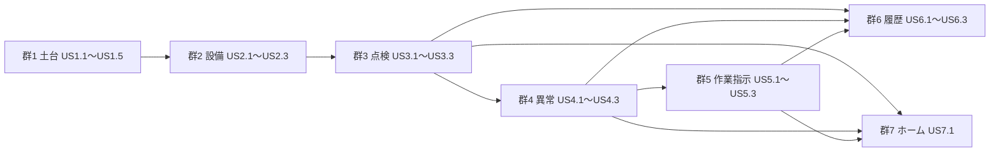

# User Stories — 工場設備保全アプリ（スマホ向け PWA）

> 入力: `requirements.md`（FR1〜FR7、NFR1〜NFR8）、`team-practices.md`、`personas.md`、`user-stories-questions.md`（Q1〜Q5、まとめ確認済み）。
> 群は要件の機能のまとまり（FR1〜FR7）に対応する（Q1）。ID（`US{群}.{番号}`、`AC{群}.{番号}.{連番}`）は後の段階で追跡に使う固定の ID。優先度は、受入基準 1〜8 と Issue の機能に直接対応するものを Must、補助の操作を Should とした（Q3）。
> 受入条件の画面はすべて幅 375px で、横スクロールなしで表示される（NFR1）。

## 群 1: 共通の土台（FR1）

### US1.1 ロールを切り替える

- **ストーリー**: どのロールの人として、画面上部のロール切替で自分のロールを選びたい。それは自分の仕事に合った表示と操作だけを使うため。
- **優先度**: Must ／ **対応**: FR1.1
- **受入条件**
  - **AC1.1.1** Given アプリを開いている When 画面上部のロール切替で「保全リーダー」を選ぶ Then 選んだロールが選択状態で表示され、保全リーダー用のホームと操作が表示される
  - **AC1.1.2** Given ロールに「保全担当者」を選んである When アプリを再読み込みする Then ロールは「保全担当者」のまま
  - **AC1.1.3** Given どの画面を開いていても When 画面上部を見る Then 3 択のロール切替が表示されている（ログイン画面はない）

### US1.2 電波がなくても使い続ける

- **ストーリー**: 現場さん（P1）として、電波の弱い場所でも点検や報告を記録したい。それは記録のために場所を移動しなくて済むため。
- **優先度**: Must ／ **対応**: FR1.2、FR1.6、NFR5（受入基準 7）
- **受入条件**
  - **AC1.2.1** Given 一度アプリを開いたことがある When 機内モードでアプリを開く Then アプリが起動し、設備一覧が表示される
  - **AC1.2.2** Given 機内モードである When 点検結果を記録して送信する Then 「点検結果を記録しました」が表示され、記録は端末内に保存される
  - **AC1.2.3** Given 機内モードで記録した When アプリを再読み込みする Then その記録が保全履歴に残っている
  - **AC1.2.4** Given 機内モードである When どの機能（点検・異常報告・作業指示・履歴・ホーム）を使っても Then 通信がないことによるエラーは出ない

### US1.3 保存できない環境で案内を見る

- **ストーリー**: どのロールの人として、保存できない環境で開いてしまったときに、それが分かるようにしたい。それは記録が消えるのに気づかず作業するのを防ぐため。
- **優先度**: Must ／ **対応**: FR1.4（受入基準 8）
- **受入条件**
  - **AC1.3.1** Given 端末に保存できない環境（プライベートブラウズ等）で開く When アプリが起動する Then 「この環境ではデータを保存できません。通常モードで開いてください」が表示される
  - **AC1.3.2** Given その環境である When 設備一覧・設備詳細・保全履歴を開く Then 内容を閲覧できる
  - **AC1.3.3** Given その環境である When 点検・異常報告・作業指示・削除の操作を探す Then それらの操作はできない（読み取り専用）

### US1.4 読み込みに失敗したデータから再開する

- **ストーリー**: どのロールの人として、保存データが読めなくなったときに、続け方を選びたい。それはアプリが使えないまま止まらないようにするため。
- **優先度**: Must ／ **対応**: FR1.5（受入基準 8）
- **受入条件**
  - **AC1.4.1** Given 保存データの読み込みに失敗した When アプリが起動する Then 「保存データを読み込めませんでした。サンプルデータで再開しますか？」と「再開する」「閉じる」が表示される
  - **AC1.4.2** Given その案内が出ている When 「再開する」を押す Then サンプルデータで初期化され、ホームが表示される
  - **AC1.4.3** Given その案内が出ている When 「閉じる」を押す Then 案内が閉じ、保存データは変わらない

### US1.5 サンプルデータで試し始める

- **ストーリー**: 統括さん（P3）として、初めて開いたときから設備と点検項目がそろっている状態で試したい。それは準備なしで PoC を評価するため。
- **優先度**: Must ／ **対応**: FR1.3
- **受入条件**
  - **AC1.5.1** Given 初めてアプリを開く When 設備一覧を開く Then 3 ライン・12 台の架空の設備が表示される
  - **AC1.5.2** Given 初めてアプリを開く When 任意の設備の点検を開く Then 4〜8 項目の点検項目が表示される
  - **AC1.5.3** Given サンプルデータ When 内容を確かめる Then 実在の工場・設備・個人の情報は含まれていない

## 群 2: 設備一覧・設備詳細（FR2）

## 群 3: 日常点検（FR3）

### US3.1 日常点検を記録する

- **ストーリー**: 現場さん（P1）として、設備の点検項目を OK / 要注意 / NG で記録したい。それは紙の点検表なしで始業点検を終えるため。
- **優先度**: Must ／ **対応**: FR3.1、FR3.2、FR3.5（受入基準 2）
- **受入条件**
  - **AC3.1.1** Given どのロールでも When 設備の点検を開く Then 点検項目ごとに OK / 要注意 / NG を選べる
  - **AC3.1.2** Given まだ記録していない項目がある When 送信しようとする Then 送信できず、残りの項目数が表示される
  - **AC3.1.3** Given すべての項目を記録した When 送信する Then 「点検結果を記録しました」が表示される
  - **AC3.1.4** Given 今日その設備を点検した When ホームを見る Then その設備は今日の未点検の設備に数えられない
  - **AC3.1.5** Given 前日に点検した設備 When 端末の日付が変わってからホームを見る Then その設備は今日の未点検の設備に数えられる

### US3.2 NG の項目から異常報告に進む

- **ストーリー**: 現場さん（P1）として、点検で NG を付けた項目から、その場で異常を報告したい。それは異常を見つけたときにすぐ伝えるため。
- **優先度**: Must ／ **対応**: FR3.3（受入基準 3）
- **受入条件**
  - **AC3.2.1** Given 点検で項目に NG を付けた When その項目の「異常を報告する」を押す Then 異常報告の入力画面が開き、対象設備と元の点検項目が入力済みになっている
  - **AC3.2.2** Given OK または要注意の項目 When 項目を見る Then 異常報告に進む操作は表示されない
  - **AC3.2.3** Given NG から作った異常報告を送信した When 未対応の異常の一覧を見る Then その異常報告が表示される

### US3.3 同じ日の点検を修正する

- **ストーリー**: 現場さん（P1）として、同じ日の点検をやり直したときに、前の結果を見ながら修正したい。それは記録を二重にせず、正しい結果を残すため。
- **優先度**: Must ／ **対応**: FR3.4
- **受入条件**
  - **AC3.3.1** Given 今日すでに点検した設備 When もう一度点検を開く Then 前回の結果が表示され、修正として記録することが案内される
  - **AC3.3.2** Given 前回の結果を変えた When 送信する Then 点検記録は 1 件のまま最新の結果に置き換わり、「修正済み」と修正した日時が残る
  - **AC3.3.3** Given 修正で NG を OK に直した When 未対応の異常の一覧を見る Then その NG から作った異常報告は残っている

## 群 6: 保全履歴（FR6）

### US6.1 設備の保全履歴を見る

- **ストーリー**: 対応さん（P2）として、設備ごとの点検・異常・作業の記録を新しい順に見たい。それは設備の過去の状態と対応をたどるため。
- **優先度**: Must ／ **対応**: FR6.1
- **受入条件**
  - **AC6.1.1** Given 点検記録・異常報告・作業指示がある設備 When 保全履歴を開く Then 3 種類の記録が新しい順に、種別・日時・要点付きで表示される
  - **AC6.1.2** Given 記録のない設備 When 保全履歴を開く Then 記録がないことが表示される

### US6.2 誤って登録した記録を削除する

- **ストーリー**: 統括さん（P3）として、誤って登録された記録を、内容を確かめてから削除したい。それは誤った記録で状況を見誤らないようにするため。
- **優先度**: Must ／ **対応**: FR6.2、FR6.3（受入基準 6）
- **受入条件**
  - **AC6.2.1** Given ロールが保全リーダー When 保全履歴を開く Then 各記録に「削除」が表示される
  - **AC6.2.2** Given ロールがオペレーターまたは保全担当者 When 保全履歴を開く Then 「削除」は表示されない
  - **AC6.2.3** Given 保全リーダーが「削除」を押した When 確認が出る Then 対象の設備名・記録日時・種別と、「削除する」「キャンセル」が表示される
  - **AC6.2.4** Given 確認が出ている When 「キャンセル」を押す Then 何も消えない
  - **AC6.2.5** Given 確認が出ている When 「削除する」を押す Then 記録が端末内のデータから消え、取り消しはできない
  - **AC6.2.6** Given 完了した作業指示を削除した When 未対応の異常の一覧・設備の状態・ホームの件数を見る Then 元の異常報告が「未対応」に戻って一覧に現れ、設備は「異常あり」になり、件数に含まれる（Q5）

### US6.3 参照されている記録の削除を止める

- **ストーリー**: 統括さん（P3）として、ほかの記録から参照されている記録を消そうとしたときに止めてほしい。それはつながった記録が壊れるのを防ぐため。
- **優先度**: Must ／ **対応**: FR6.4
- **受入条件**
  - **AC6.3.1** Given 作業指示がある異常報告 When 削除しようとする Then 「関連する作業指示があるため削除できません」が表示され、何も消えない
  - **AC6.3.2** Given NG の項目から異常報告を作った点検記録 When 削除しようとする Then 「関連する異常報告があるため削除できません」が表示され、何も消えない
  - **AC6.3.3** Given 参照している側（作業指示）を先に削除した When 元の異常報告を削除する Then 削除できる

## 群 7: ホーム（FR7）

### US7.1 ロールに合った件数を見て一覧へ進む

- **ストーリー**: 統括さん（P3）として、ホームで未点検・未対応・対応中の件数を見て、そこから一覧へ進みたい。それは工場全体の状況を一目で把握し、すぐに手を打つため。
- **優先度**: Must ／ **対応**: FR7.1、FR7.2
- **受入条件**
  - **AC7.1.1** Given ロールがオペレーター When ホームを開く Then 今日の未点検の設備数と、重要度別の未対応の異常数が表示される
  - **AC7.1.2** Given ロールが保全担当者 When ホームを開く Then 重要度別の未対応の異常数と、対応中の作業数が表示される
  - **AC7.1.3** Given ロールが保全リーダー When ホームを開く Then 3 つの件数がすべて表示される
  - **AC7.1.4** Given ホームの件数 When 件数を押す Then その一覧（未点検の設備・未対応の異常・対応中の作業）が開く

## 依存関係

文章での説明: 群 1（土台）はすべての前提。設備（群 2）→ 点検（群 3）→ 異常（群 4）→ 作業指示（群 5）の順にデータがつながる。履歴（群 6）とホーム（群 7）は、点検・異常・作業指示の記録を表示するので、それらに依存する。US3.2 は US4.1 の入力画面を使い、US6.2 の AC6.2.6 は US5.2 の完了に依存する。

## INVEST の確認

- **独立**: 群の中のストーリーは別々に作って確かめられる。群をまたぐ依存は上の図のとおりで、データのつながりによる最小限のもの。
- **交渉可能・価値**: 各ストーリーに「それは〜のため」の価値を書いた。画面の形は詳細モックアップで決める。
- **見積もれる・小さい**: 1 本あたりの受入条件は 2〜6 個。
- **テストできる**: 受入条件はすべて Given / When / Then で、E2E テスト（375×812）か単体テストで確かめられる。

## Assumptions & Open Questions

- [assumption] 優先度は Q3 の基準で付けた結果、すべて Must になった（どのストーリーも Issue の機能か受入基準に直接対応するため）。
